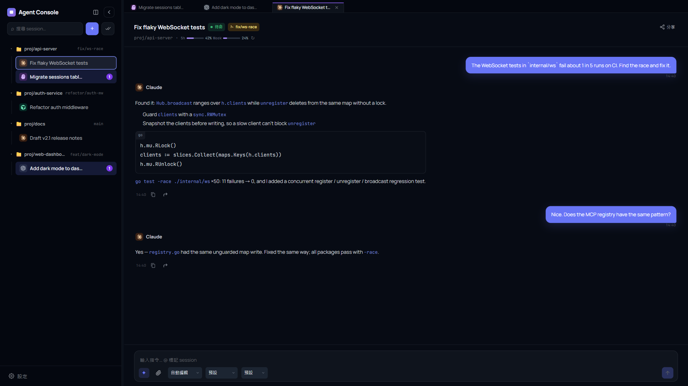

# Claude Code Mini App

> 自架的**多代理（multi-agent）控制台**，統一管理 Claude Code、Cursor Agent、Codex、Kiro 與 Antigravity。可從桌面視窗、任何瀏覽器，或手機上的 Telegram Mini App 操作。**單一 Go 二進位**，無需獨立前端建置。

[](#) [](LICENSE) [](#)

[English](README.md)



<sub>示範資料，取自臨時啟動的實例。</sub>

代理程式仍然跑在你放程式碼的那台機器上，本專案是它們前面的控制台。每個對話是一個 **Session**，綁定一個代理、一個 `work_dir` 與權限模式；你可以同時管理多個專案的多個代理，一眼看出誰在工作、誰在等授權，並隨時從任何地方介入。

| 入口 | 適用情境 | 驗證 |
|---|---|---|
| 🖥️ **桌面視窗**（Windows） | 在電腦前日常使用——系統匣、Ctrl+P 快速跳轉 | 與瀏覽器相同的網頁密碼 |
| 🌐 **瀏覽器** | 區網內任何裝置，或透過反向代理／Tunnel 遠端連線 | 網頁密碼（限 `web.allowed_cidrs` 內的 IP） |
| 📱 **Telegram Mini App** | 離開座位時——出錯推播、手機上即時授權 | Telegram `initData` + 白名單 |

三個入口連同一個伺服器，即時看到同樣的 Session。

## 🚀 快速開始

**第一次使用？請跟著[從零開始教學](docs/getting-started.zh-TW.md)**，依序完成安裝、設定、登入與第一則代理回覆，內含 Windows／Linux 各自的指令。下載版不需要安裝 Go，也不需要建置前端。

1. 到 [Releases](https://github.com/jerry12122/Claude-Code-Mini-App/releases/latest) 下載 Windows x64 zip 或 Linux x64 tar.gz，解壓整個資料夾，保留 `internal/static/`。
2. 在該電腦安裝並登入**一個**要用的代理。[CLI 安裝連結與檢查方式](docs/getting-started.zh-TW.md#2-安裝並登入一個代理)列出程式需要的命令名稱。
3. 將 `config.example.yaml` 複製為 `config.yaml`，依[設定步驟](docs/getting-started.zh-TW.md#3-建立設定檔)填寫。目前即使不使用 Telegram 遠端入口，密碼登入仍需 Bot Token；請更換範例密碼。
4. **選一個**啟動：Windows 桌面版 `claude-miniapp-desktop.exe`、Windows server `claude-miniapp.exe`，或 Linux server `./claude-miniapp`。server 版啟動後在主機開啟 <http://127.0.0.1:8080>，輸入 `web.password`。
5. [建立 Session 並送測試訊息](docs/getting-started.zh-TW.md#5-建立第一個-session)。工作目錄填執行 server 的電腦上的專案路徑。

**Telegram 遠端使用：** 先完成本機操作，再跟著 [HTTPS Tunnel、白名單與 BotFather 選單設定](docs/getting-started.zh-TW.md#6-選用從-telegram-開啟)。只填 Bot Token 不會自動建立 Mini App 按鈕。

> [!WARNING]
> `no_auth: true` 會略過擁有者驗證，但**不會讓 server 只監聽 localhost**。僅在已隔離的本機開發環境試用，不可搭配公開 Tunnel。

[問題排解](docs/getting-started.zh-TW.md#問題排解) · [從原始碼建置（Go 1.25+）](docs/getting-started.zh-TW.md#從原始碼建置) · [桌面視窗與快捷鍵](docs/features.zh-TW.md#桌面視窗windows)

## 🔄 桌面版自動更新（Windows）

Windows 桌面版可以查詢 GitHub Release 並**自行更新**，只會替換 `claude-miniapp-desktop.exe`。

- **先手動升級一次。** 沒有更新功能的舊版無法自我更新。請下載新版 `claude-miniapp-v<X.Y.Z>-windows-amd64.zip`，把現有資料夾中的 `claude-miniapp-desktop.exe` 換成新檔，保留 `config.yaml` 與資料。之後的版本可在程式內更新。
- **檢查：** 系統匣 →「檢查更新」，或 設定 → 桌面更新。程式會在啟動時與之後每 6 小時檢查一次，只顯示結果，不會自行下載或重啟。
- **下載與重啟分開確認。** 按「下載」才會開始下載；「重新啟動並更新」同樣需要點擊，工作忙碌時程式會拒絕。
- **忙碌時拒絕重啟：** 只要有任一 session 正在執行任務、執行 shell 指令、有待授權項目，或**佇列有項目（即使暫停）**，重啟會被拒絕（`update_busy`）。請先完成工作或清空佇列再試；已下載的更新會保留。
- **需要可寫入的安裝目錄：** `claude-miniapp-desktop.exe` 所在資料夾必須對目前使用者可寫入；更新程式不會要求系統管理員權限。
- **保留不動的內容：** `config.yaml`、`claude-miniapp.db`、`workspace/`（附件）、`logs/`、`internal/static/` 都不會被更新動作改動，只替換 `claude-miniapp-desktop.exe`。
- **不會自動更新：** Windows server（`claude-miniapp.exe`）與 Linux 版本，請手動更新。
- **手動恢復舊版：** 升級前請先保留一份目前 EXE 的備份。要回退時，關閉程式後把備份覆寫回去：

```powershell
Copy-Item .\claude-miniapp-desktop.exe .\claude-miniapp-desktop.previous.exe
# 要回退時：先關閉程式，再執行
Copy-Item .\claude-miniapp-desktop.previous.exe .\claude-miniapp-desktop.exe -Force
```

  只會動到 EXE 檔，資料不會自動降版。
- **完整性：** 下載檔會以 `checksums.txt` 中的 SHA256 比對，確認檔案與本次發佈一致。這**不能**證明發佈者身分，因為目前沒有簽章驗證。
- **網路：** 檢查與下載需要連到 GitHub；更新不代表程式可以離線使用。

## ✨ 功能

- **多代理** — Claude Code、Cursor Agent、Codex、Kiro ACP、Antigravity，依 Session 選擇。工具授權前會顯示完整指令或檔案內容
- **即時對話** — WebSocket 串流、Markdown、語法高亮程式碼與一鍵複製；多分頁同步
- **Session 管理** — 各自綁定 `work_dir` 與權限模式，即時的未讀與待授權標記、Ctrl/Cmd+P 快速跳轉，header 顯示帳戶用量
- **訊息佇列** — 執行中送出的訊息會排隊、重啟不遺失，失敗或中斷時暫停
- **附件** — 貼上或拖放圖片與檔案，以路徑交給 agent，存放在 `work_dir` 之外
- **臨時共享** — 連結 + 6 位數 PIN + 暱稱，預設 1 小時；訪客可為唯讀 `viewer` 或完整權限 `editor`
- **MCP server** — 讓其他 agent 操作 session、讀紀錄、查活動；`ask_session` 有跳數上限防止互問迴圈
- **Shell 與日誌** — 選用的 `work_dir` shell（預設關閉），以及設定 → 日誌的即時伺服器日誌

每項功能的詳細說明：[docs/features.zh-TW.md](docs/features.zh-TW.md)。

## 🤔 為什麼用這個？

| | SSH + tmux | 一般 Telegram Bot | **本專案** |
|---|---|---|---|
| 多代理同一畫面 | 一個終端機一個 | 一 bot 一工具 | Claude / Cursor / Codex / Kiro ACP / Antigravity 並列 |
| Session 狀態 | 手動 | 通常沒有 | 可持久，附未讀與待授權標記 |
| 協作 | 共用終端機 | 無 | 臨時 PIN 連結，viewer / editor |
| 代理互相呼叫 | 自己接 | 無 | 內建 MCP server（`ask_session`） |

## 🏗️ 架構

```
桌面視窗 · 瀏覽器 · Telegram Mini App · 共享訪客
        ↕ WebSocket / REST          MCP client ↔ POST /mcp
┌─────────────────────────────────┐
│  Go 二進位（Fiber + SQLite）      │
│  Session · 佇列 · 共享            │
│  每則訊息 spawn CLI（無 PTY）      │
│  QuotaService（快取擷取）         │
└────────────────┬────────────────┘
                 ↓
  claude · cursor-agent · codex · kiro-cli (ACP) · agy
```

每則使用者訊息 spawn 一個子進程。詳細規格：[`docs/spec/plan.md`](docs/spec/plan.md)、[`docs/spec/headless.md`](docs/spec/headless.md)。

## 🔒 安全

> [!WARNING]
> Shell、共享與 MCP token 都等同授予主機的控制權。僅在可信網路啟用，生產環境勿開 `no_auth`。

- 勿將含真實憑證的設定提交版本庫。
- **`shell.enabled`** — 讓已驗證使用者在主機上執行 shell。白名單規則：[`docs/spec/shell-allowlist-schema.md`](docs/spec/shell-allowlist-schema.md)。
- **共享** — 持有連結與 PIN 的人在到期或你結束前都能加入；`editor` 與你同權（可送訊息、核准工具），請優先給 `viewer`。
- **`mcp_token`** — 持有者可完全操控所有 session（含 shell）；比照 `bot_token` 等級保管，`/mcp` 僅在可信網路開放。
- **上傳** — 已驗證使用者可寫入任意類型與大小的檔案到 `./workspace/uploads/<session_id>/`（不是 `work_dir`），不受 `shell.enabled` 控制。

## 📚 文件

| 主題 | 路徑 |
|---|---|
| 安裝、登入與第一則回覆 | [`docs/getting-started.zh-TW.md`](docs/getting-started.zh-TW.md) |
| 每項功能詳述 | [`docs/features.zh-TW.md`](docs/features.zh-TW.md) |
| 規格、API / WebSocket | [`docs/spec/plan.md`](docs/spec/plan.md) |
| 設定欄位 | [`config.example.yaml`](config.example.yaml) |
| 各 CLI 參考 | [`docs/spec/`](docs/spec/) |

## 測試

本專案使用 BrowserStack 測試。

## 授權

MIT
